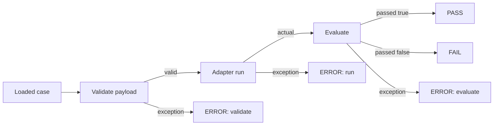
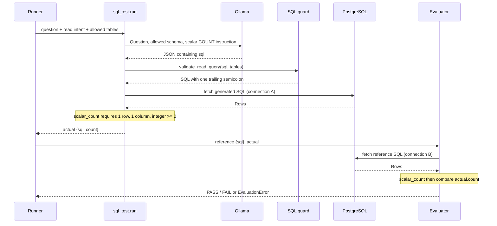
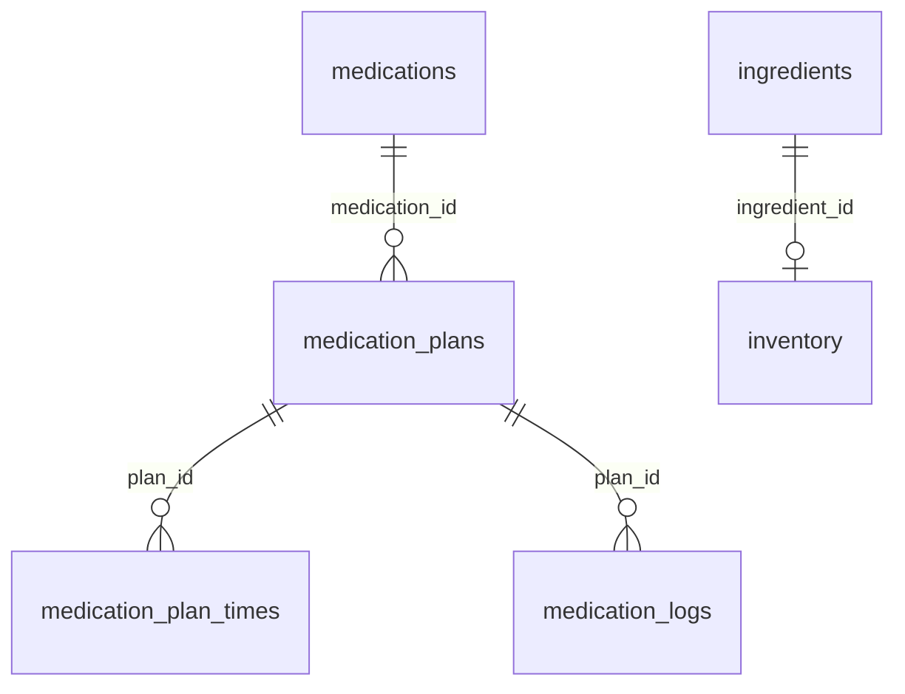

# Eval Harness — Low-Level Design

This document describes the implementation in this repository. It expands [WALKTHROUGH.md, Section 2](WALKTHROUGH.md#2-architecture-overview) into function contracts, execution order, data structures, trust boundaries, and operational behavior. Limitations below describe current behavior; suggested extensions are not implemented.

## 1. Scope and execution boundary

The harness is a synchronous Python CLI with three independently evaluated suites. It invokes local adapter functions, which call the Ollama CLI; the SQL adapter also queries PostgreSQL. It does not invoke the production OmniFlow API, import application code, run retrieval, or perform dashboard mutations.

`--script all` runs `intent`, `sql`, and `llm_judge` in registry order. It does **not** pass intent output into SQL or SQL rows into answer generation. SQL inputs already specify read intent and permitted tables; answer-generation inputs already contain retrieved records. Case IDs are local to each suite.

| Suite | Questions / reference files under `data/` | Adapter | Mode | Cases |
| --- | --- | --- | --- | ---: |
| `intent` | `intent_question.json` / `intent_ground_truth.json` | `scripts.intent_test` | `exact` | 10 |
| `sql` | `sql_test_questions.json` / `sql_ground_truth.json` | `scripts.sql_test` | `query_result` | 8 |
| `llm_judge` | `llm_test_questions.json` / `llm_ground_truth.json` | `scripts.llm_judge_test` | `fuzzy` | 8 |

A successful complete execution attempts 34 inference calls: 10 classifications, 8 SQL generations, and 8 answer/judge pairs. There are also three model-availability subprocesses, one SQL schema-preflight connection, and 16 SQL query connections. Failures can reduce these counts.

## 2. Source ownership and dependencies

| Source | Responsibilities and callable contracts |
| --- | --- |
| [`core/__main__.py`](core/__main__.py) | Delegates `python -m core` to `loader.main()` and exits with its return value. |
| [`core/loader.py`](core/loader.py) | CLI `main(argv) -> int`; `load_cases(Path, Path) -> list[dict]`; `validate_case_payload(suite, case) -> None`; `LoaderError(ValueError)`. |
| [`core/runner.py`](core/runner.py) | `SCRIPTS` wiring; dynamic adapter import; `run_script(name, log, case_id=None) -> totals`; manifests and per-case error isolation. |
| [`core/evaluator.py`](core/evaluator.py) | `evaluate(mode, ground_truth, actual, judge=None) -> EvalResult`; `EvalResult(passed: bool, reason: str)`; `EvaluationError(RuntimeError)`. |
| [`core/ollama.py`](core/ollama.py) | `ensure_model_available(model=None)` and `run_model(prompt, schema=None, model=None) -> str`; sole inference subprocess boundary. |
| [`core/config.py`](core/config.py) | Reads model and timeout dynamically from environment; constructs inference manifest configuration. |
| [`core/db.py`](core/db.py) | Connection lifecycle, schema preflight, query helpers, scalar contracts; `DatabaseContractError(RuntimeError)`. |
| [`core/schema_contract.py`](core/schema_contract.py) | `SCHEMA_VERSION = "fixture-v1"`, `TABLE_FIELDS`, and `prompt_schema(tables)`. Shared by SQL prompts and schema preflight. |
| [`core/sql_guard.py`](core/sql_guard.py) | `validate_read_query(sql, allowed_tables=None) -> str`; PostgreSQL AST checks and physical-relation restrictions. |
| [`core/run_log.py`](core/run_log.py) | `RunLog`: stdout/readable logging, JSONL records, file lifecycle. |
| [`scripts/intent_test.py`](scripts/intent_test.py) | `run(input) -> {intent, actions}`. |
| [`scripts/sql_test.py`](scripts/sql_test.py) | `run(input) -> {sql, count}`. |
| [`scripts/llm_judge_test.py`](scripts/llm_judge_test.py) | `run(input) -> {answer, context}` and `judge(input, ground_truth, actual) -> {passed, reason}`. |
| [`scripts/model_output.py`](scripts/model_output.py) | Shared structured-output parser `final_json(raw) -> Any`. |
| [`scripts/db.py`](scripts/db.py) | Compatibility re-exports of `connect`, `execute`, `fetch`, and `scalar_value`; active SQL adapter imports `core.db` directly. |
| [`db/`](db/) | Role initialization/migration and explicitly invoked fixture replacement. |
| [`tests/test_harness.py`](tests/test_harness.py) | Offline regression tests using mocks and temporary fixtures. |

`core.loader.main` imports the runner locally: the runner itself imports loader helpers. The registry holds module-name strings rather than imported adapter objects. An adapter is resolved with `importlib.import_module`, and `run` must be callable. There is no plugin discovery, HTTP server, worker queue, or persistent result database.

## 3. CLI and orchestration

### 3.1 Invocation

```bash
python -m core.loader --script all
python -m core --script sql --case-id 8
```

`--script` defaults to `all` and accepts registry keys. `--case-id` is a string and requires one suite; combining it with `all` is an argparse error before log creation.

### 3.2 Exact order of operations

```mermaid
sequenceDiagram
    participant CLI as loader.main
    participant DB as core.db
    participant R as runner.run_script
    participant L as loader.load_cases
    participant O as core.ollama
    participant A as Adapter
    participant E as evaluator.evaluate
    participant Log as RunLog
    CLI->>Log: Create one log / JSONL pair
    loop Selected suites in registry order
        opt Suite is sql
            CLI->>DB: validate_database_contract()
        end
        CLI->>R: run_script(name, log, case_id)
        R->>L: Load, join, validate file structure
        L-->>R: Cases in question-file order
        Note over R: Filter ID; import adapter; check run and judge
        R->>O: ensure_model_available()
        R->>Log: Suite header and manifest
        loop Cases
            Note over R: Validate adapter-facing input shape
            R->>A: run(case.input)
            A-->>R: actual
            R->>E: evaluate(mode, truth, actual, judge)
            E-->>R: EvalResult
            R->>Log: PASS / FAIL / ERROR record
        end
        R-->>CLI: Suite totals
    end
    CLI->>Log: Close both files in finally
    Note over CLI: Print aggregate totals to stderr; return exit status
```

The diagram shows the normal path. Validation, adapter, and evaluator exceptions each have their own per-case handler. They increment `errors`, write an error record, and continue to the next case.

Important ordering consequences:

- SQL database preflight belongs to `main`, not `run_script`. Directly calling `run_script("sql", ...)` bypasses it.
- Full file loading and ID matching happen before filtering, so an invalid unrelated row can prevent a selected case from running.
- Model availability is checked after import but **before per-case payload validation**, even for an empty case list.
- A callable judge is required for a fuzzy suite before model calls. The evaluator's standalone exact-match fallback is therefore unreachable for a configured fuzzy suite through the runner.
- Manifest writing happens after model preflight. A failed preflight produces no manifest for that suite.
- Cases are processed sequentially; there is no retry, resume, cancellation protocol, or parallel execution.

### 3.3 Case state and totals



`run_script` returns `{"total": N, "passed": P, "failed": F, "errors": E}`. For a completed suite, `N = P + F + E`. A handled suite-level exception instead contributes `{total: 0, passed: 0, failed: 0, errors: 1}`, so aggregate errors can exceed the number of cases counted.

| Exit status | Condition |
| --- | --- |
| `0` | All selected suites contain cases and all cases pass. |
| `1` | Any case fails/errors, or a selected suite returns zero cases. |
| `2` | Invalid CLI arguments or a handled suite-level configuration/execution exception. |

Status uses `max`, so a later success cannot clear an earlier failure. `no_results` becomes `1` only when aggregate `total == 0`; an empty suite alongside a nonempty suite still forces status 1 but leaves `no_results == 0`.

The suite handler catches `LoaderError`, `ValueError`, `AttributeError`, and `RuntimeError`. It does not catch every possible exception: import errors, some filesystem errors, or unexpected database exceptions can escape and terminate processing. `finally` closes logs once execution enters that block; log construction happens before it. Per-case handlers catch `Exception`, not `BaseException` such as keyboard interruption.

## 4. Fixture loading and data contracts

### 4.1 File-to-case transformation

Both files must contain JSON arrays. Each item must be an object with `id`. All other fields are preserved verbatim; fields are not renamed, recursively sanitized, or semantically corrected.

```json
// Question row
{"id": 2, "query": "What is the title of my task?", "results": []}
// Matching reference row
{"id": 2, "ideal_output": "Your task is titled Buy milk."}
// Internal case produced by load_cases
{
  "id": 2,
  "input": {"query": "What is the title of my task?", "results": []},
  "ground_truth": {"ideal_output": "Your task is titled Buy milk."}
}
```

The comments above annotate separate objects; the files themselves contain strict JSON arrays.

Identity is `(type(value).__name__, json.dumps(value, sort_keys=True, separators=(",", ":")))`. This distinguishes numeric `1`, string `"1"`, boolean `true`, and float `1.0`. Null IDs are accepted; array/object IDs are rejected. Duplicate identities within either file, missing reference IDs, and unused reference IDs fail loading. Question order determines execution order, regardless of reference order.

The loader rejects top-level `actual` in questions and matched references: actual output must come from execution. Both empty arrays produce an empty suite; blank files are errors. The implementation uses Python's default JSON decoder without additional non-finite-number rejection.

CLI filtering compares `str(case["id"])` with the requested string. Thus `1` and `"1"` can coexist in fixtures but selecting `--case-id 1` is ambiguous and errors. Zero matches also error.

### 4.2 Adapter-facing contracts

| Suite | Input validation before adapter call | Reference consumed by evaluator | Actual returned by adapter |
| --- | --- | --- | --- |
| Intent | Object; nonblank string `query`. | Entire object, normally `{intent, actions: []}`. | `{intent: "read" \| "write" \| "chat", actions: []}`. |
| SQL | Nonblank string `question`; nested object `input`; `input.intent == "read"`; nonempty list of string `input.tables`. | Object with nonblank string `sql`. | `{sql: normalized_string, count: nonnegative_int}`. |
| Grounded answer | Nonblank `query`; `results` or fallback `context` is a list; every record has `source_table`, `source_id`, and object `metadata`. | Object with string `ideal_output`. | `{answer: string, context: original_records}`. |

Payload validation does not validate reference semantics or reject extra input keys. Grounded record source fields must exist but have no type/domain checks; arbitrary metadata is accepted. `results` takes precedence whenever present, even if its value is null and `context` is valid.

SQL validation is layered: the loader checks that table names are strings, while the adapter checks membership in `TABLE_FIELDS`. Direct SQL adapter calls also accept `query` instead of `question` and a flat `{intent, tables}` shape; CLI validation requires the nested form above.

## 5. Model calls and response parsing

### 5.1 Shared subprocess boundary

`ensure_model_available` executes `ollama show <configured-model>` with captured output, `check=True`, and a fixed 10-second timeout. OS/subprocess failures are wrapped in `RuntimeError` with a model-availability message. It checks the configured default model, not a grounded-answer per-case model override.

`run_model` builds an argument list, without a shell:

```text
ollama run <model> <prompt> [--format <JSON schema>]
```

It captures stdout/stderr as text, raises on nonzero exit, applies the configured inference timeout, and returns stdout. The prompt is a command argument rather than stdin. There is no streaming, retry, batching, token accounting, explicit temperature/seed, or model-digest pinning. `OLLAMA_HOST` is inherited by the CLI.

### 5.2 Intent/SQL structured parser

`final_json` performs these steps:

1. Remove ANSI escape sequences and surrounding whitespace.
2. Repeatedly remove complete **leading** `<think>...</think>`, `<redacted_thinking>...</redacted_thinking>`, or `Thinking... ...done thinking.` wrappers.
3. Reject a remaining leading `Thinking...` as unfinished reasoning.
4. Unwrap one whole-response fenced block with no language, `json`, or `sql`.
5. Decode the entire remaining response using `json.loads`.

It never searches reasoning text for a convenient JSON substring. Multiple JSON objects and trailing prose fail. Tags inside JSON strings remain data. JSON decode errors include at most 2,000 characters of raw output in their error message.

The supplied JSON schemas prohibit additional properties, but intent and SQL adapters do **not** independently enforce exact key sets after parsing. Intent extracts and validates `intent`, then constructs a fresh result; SQL extracts a nonblank `sql`. Extra model keys can therefore be discarded rather than rejected if the model bypasses schema enforcement.

### 5.3 Grounded-answer/judge parser differs

`llm_judge_test._strip_thinking` removes ANSI codes, complete reasoning tags anywhere, a complete leading textual trace, and a remaining leading `Thinking...` prefix. It is more permissive than `final_json`, does not unwrap code fences, and can remove tag-like content embedded in an answer or verdict string. Empty answer strings are not rejected before judging.

The judge decodes with `json.loads(raw, strict=False)` to tolerate literal control characters such as newlines inside a reason. It then requires exactly `passed` and `reason`, with a strict boolean and string. Malformed structure, fenced JSON, trailing objects, or wrong types produce evaluation-stage errors.

## 6. Suite implementations and verdicts

### 6.1 Intent

The prompt sees only the current query. It defines explicit dashboard mutations as `write`, dashboard questions/searches/reports as `read`, and general help/conversation as `chat`. No retrieved records or database connection participate.

The model returns an intent; the adapter always adds `actions: []`. Action generation is not evaluated. `evaluate("exact", ...)` uses Python `==` on entire objects, with no normalization. Dictionary key order is irrelevant, extra/missing keys matter, and lists retain order. This is Python object equality, not a separate strict JSON-schema validator.

Invalid response parsing or intent produces `ERROR/run`; a valid but incorrect intent produces `FAIL/evaluate`.

### 6.2 SQL generation and reference comparison



The prompt includes only the allowed tables' advertised fields and explicitly requests one scalar `COUNT(*)`. Domain instructions distinguish `medication_plans.active` from nonexistent `is_active`, and `media_items.status = 'completed'` from a nonexistent completed boolean.

The guard enforces read-query shape and relations; it does **not** require a `COUNT(*)` node. `scalar_count` enforces observable result shape: exactly one row with one column, whose value is a Python integer, not boolean, and is nonnegative. A constant integer SELECT can satisfy that contract. Decimal counts are rejected even if mathematically integral.

Evaluator behavior, in order:

1. Non-object inputs, missing/blank reference SQL, or missing `actual.count` return a failed verdict.
2. Execute reference SQL and extract `scalar_count`; wrap any exception as `EvaluationError("reference query failed: ...")`.
3. Reject boolean, noninteger, or negative `actual.count` with a failed verdict.
4. Compare expected and actual integers; include both values in the reason.

A reference failure therefore takes precedence over an invalid actual count's type when a count key exists. The evaluator trusts `actual.count` and does not re-execute or inspect `actual.sql`. Reference SQL bypasses `validate_read_query` and the case table allowlist; it runs through the same read-only database helper.

Generated and reference queries use independent connections and snapshots. Concurrent fixture changes can produce inconsistent comparisons. Count equality is only equality on the current data: different predicates, constant answers, or wrong selections can pass by coincidence.

### 6.3 Grounded answer and judge

Generation builds compact JSON records with this mapping:

| Input record field | Generation prompt field |
| --- | --- |
| `source_table` | `source_table` |
| `source_id` | `source_id` |
| `metadata` | `fields` |
| Optional `text` | `search_text`, default `""` |

Other record fields are omitted from the generation prompt but retained in returned `context`. Records are not fetched from PostgreSQL. The prompt requires grounding in labeled fields, ignoring instructions embedded in records, admitting insufficient evidence, and avoiding claims of mutations.

Generation uses `input.model` when truthy, otherwise the configured model. The judge always uses the configured model. Its evidence is the original input records, query, reference `ideal_output`, and `actual.answer`; it does not use `actual.context` as its source of truth. Ground truth is withheld from generation and supplied only to judging.

The rubric accepts paraphrases, quoted record text, factual descriptions such as “not completed,” and negated mutation claims. Empty retrieval supports “no matching records were supplied,” not “the dashboard contains zero records.” Instruction-following from record fields, invented facts, irrelevant answers, and unsupported mutations should fail according to the prompt. These are model judgments, not deterministic predicates.

The runner adapts the three-argument judge to the evaluator's two-argument callback:

```python
judge=lambda truth, got: adapter_judge(case["input"], truth, got)
```

`_from_judge` is broader than the active adapter: it accepts a validated `EvalResult`, a boolean, or a dictionary with exactly one boolean `pass`/`passed` field plus optional string `reason`. Unknown fields or both verdict keys error. The active adapter always returns the narrower `{passed, reason}` contract.

## 7. SQL guard internals and protection boundaries

`validate_read_query` returns the original SQL text with outer whitespace removed and one trailing semicolon. It parses a separately normalized copy; it does not transpile or execute the AST.

1. Tokenize with the PostgreSQL tokenizer and lowercase unquoted `VAR` identifiers; preserve quoted identifier case and string literals.
2. Parse using `sqlglot.parse(..., read="postgres")`; require exactly one statement.
3. Require an `exp.Select` root. Read-only CTEs attached to SELECT are supported; a top-level UNION/set operation is not an accepted root.
4. Reject `exp.Into` anywhere and nodes named `Alter`, `Command`, `Copy`, `Create`, `Delete`, `Drop`, `Insert`, `Merge`, `Refresh`, `Set`, `Truncate`, `Update`, or `Vacuum`.
5. When an allowlist is supplied, traverse all scopes and inspect physical `exp.Table` sources. CTE/derived scope references are excluded, but physical relations inside their definitions and nested queries are checked.
6. Resolve relation names: explicit `public` is equivalent to unqualified access; other schemas retain a qualified name and fail the adapter's bare-name allowlist; catalog qualification errors. Preserve quoted case when comparing names.

Examples: allowing `tasks` permits `public."tasks"` and a CTE reading tasks, but rejects `other.tasks`, `"Tasks"`, and a nested read of recipes. CTE shadowing is resolved through scopes rather than textual matching.

This is a bounded SQL policy, not a full SQL sandbox. It has no column validation, function allowlist, cost estimator, mandatory physical-table reference, or search-path pinning. Parser acceptance does not guarantee PostgreSQL execution success. Database privileges, read-only transaction defaults, and timeouts are independent protections; they do not prove semantic correctness.

## 8. PostgreSQL access and schema

### 8.1 Connections and helpers

Each `fetch` opens a fresh `psycopg` connection and cursor using context managers, executes the query, materializes all rows as dictionaries, and closes resources. There is no pool or cross-query transaction. Connection options set `default_transaction_read_only=on`, statement timeout, lock timeout, and connect timeout.

`connect` requires `DATABASE_URL`. Connection-time `psycopg.OperationalError` becomes `DatabaseContractError`; its message suggests authentication/migration checks even when the underlying failure is network-related. Query-time failures propagate to the calling stage.

`execute` explicitly commits and returns row count but uses the same read-only connection settings; it is not a write connection for seeding. `scalar_value` is a separate, looser utility: no rows -> `None`, one cell -> normalized scalar, otherwise normalized rows. Its Decimal-to-int/float conversion is not used by strict `scalar_count`.

### 8.2 Schema preflight

`validate_database_contract` derives expected column names from `TABLE_FIELDS`, queries visible `information_schema.columns` for `public`, and errors for missing tables/columns. Extra columns are allowed. It does not verify column types, foreign keys, seed contents, row counts, table ownership, absence of write privileges, or actual schema-version metadata. The schema version is a code constant, not a database migration record.

### 8.3 Fixture tables

All tables use `id BIGSERIAL PRIMARY KEY`. Below, `!` means `NOT NULL`; omitted markers mean nullable. Full DDL is in [`db/seed_test_data.sql`](db/seed_test_data.sql).

| Table | Columns excluding `id` | Seed rows |
| --- | --- | ---: |
| `tasks` | `title TEXT!`, `description TEXT`, `priority TEXT! = 'medium'`, `completed BOOLEAN! = FALSE`, `due_date DATE` | 5 |
| `medications` | `name TEXT! UNIQUE`, `common_dosage TEXT`, `notes TEXT` | 2 |
| `medication_plans` | `plan_name TEXT!`, `medication_id BIGINT! FK`, `dosage TEXT`, `notes TEXT`, `active BOOLEAN! = TRUE` | 2 |
| `medication_plan_times` | `plan_id BIGINT! FK`, `schedule_time TIME!` | 2 |
| `medication_logs` | `plan_id BIGINT! FK`, `taken_at TIMESTAMPTZ`, `scheduled_time TIME`, `notes TEXT` | 0 |
| `exercise_catalog` | `name TEXT! UNIQUE`, `muscle_group TEXT!`, `equipment TEXT`, `description TEXT` | 2 |
| `recipes` | `name TEXT!`, `description TEXT`, `instructions TEXT`, `difficulty TEXT`, `prep_time_minutes INTEGER` | 2 |
| `ingredients` | `name TEXT! UNIQUE`, `category TEXT! = 'Other'`, `default_unit TEXT! = 'piece'` | 2 |
| `inventory` | `ingredient_id BIGINT! UNIQUE FK`, `quantity NUMERIC(10,2)!`, `unit TEXT!`, `expiry_date DATE`, `min_quantity NUMERIC(10,2)! = 0` | 2 |
| `media_items` | `title TEXT!`, `media_type TEXT!`, `status TEXT! = 'to_watch'`, `genre TEXT`, `author_creator TEXT`, `progress_current INTEGER! = 0`, `progress_total INTEGER`, `is_favorite BOOLEAN! = FALSE`, `rating NUMERIC(3,1)` | 2 |



Tasks, exercises, recipes, and media have no declared relationships to other fixture tables. No recipe-ingredient join table exists. Status/priority/category fields are text without enums or CHECK constraints; numeric nonnegativity is not enforced by the DDL. Indexes arise from primary/unique constraints; no explicit additional indexes are declared.

The seed uses fixed values anchored to 2026-01-15. It includes four incomplete tasks, one completed task, one active plan, one below-minimum inventory entry, one completed media item, and an instruction-injection string in a task description. Sequence values are explicitly set; even the empty `medication_logs` sequence is set to 1 with `is_called=TRUE`, so its next generated ID is 2.

On the unmodified seed, SQL reference cases 1–8 return `4, 1, 2, 1, 2, 2, 1, 1`. **Case 1 asks “How many tasks do I have?” while the reference filters `completed = FALSE`.** A plausible all-task count of 5 fails that reference. The harness deliberately does not reconcile question/reference semantics.

### 8.4 Roles, reset, and migration

| Role | Provisioning/use |
| --- | --- |
| `admin` | Fresh Compose PostgreSQL initialization superuser. |
| `eval_seed` | Login with CREATEDB; owns `omniflow` database and `public` schema; runs fixture replacement. |
| `eval_app` | Runtime login; granted database CONNECT, schema USAGE, table SELECT, and sequence USAGE/SELECT. |

`init-users.sql` runs only on a fresh PostgreSQL data directory. It creates roles and changes database/schema ownership; table grants arrive during seeding.

`reset_and_seed.sh` requires `PGHOST`, `PGUSER`, `PGDATABASE`, and `SEED_FILE`, waits for readiness up to `RESET_TIMEOUT_SECONDS`, then uses `psql -v ON_ERROR_STOP=1` for one transaction: drop public with CASCADE, recreate it, include seed DDL/data, grant app access, commit. Failure prevents committing a partially replaced fixture. This is destructive fixture replacement and only belongs to the explicit `seed` profile.

`migrate_existing_roles.sql` creates missing roles, changes database/schema ownership, grants access to existing tables/sequences, and prints privilege checks. It preserves table data, does not add missing schema columns, does not reset passwords of existing roles, and does not revoke preexisting write privileges. Neither provisioning path declares default privileges for future tables. Existing-volume schema upgrades require separate work.

## 9. Logging and error observability

One CLI invocation creates one pair of files shared by all selected suites:

```text
<EVAL_LOG_DIR>/<UTC timestamp with microseconds>_<10 hex UUID characters>_<label>.log
<EVAL_LOG_DIR>/<same basename>.jsonl
```

The label is the script selection, optionally suffixed with `_case<case-id>`. Files use exclusive creation (`"x"`). `line()` prints to stdout, writes readable output, and flushes; `record()` appends to both an in-memory `summary` list and JSONL, then flushes. JSON serialization uses `default=str`. Flushes do not provide transactional or fsync durability across the two files.

### 9.1 Manifest contract

One manifest per suite that passes preflight contains:

```text
type="manifest", suite, mode, questions, ground_truth,
model, inference={model, timeout_seconds, retries:0}, judge_configured,
schema_version, questions_sha256, ground_truth_sha256, seed_sha256
```

Paths are repository-relative where possible. Hashes cover the entire files even for a single-case run; the seed is hashed for every suite. These are source-file hashes, not verification of database contents. The manifest does not capture adapter/core hashes, actual model digest, package versions, database snapshot, prompt text, inference seed/temperature, or per-case generation-model overrides. Files are read for loading and subsequently read again for hashing, so concurrent edits are not guarded against.

### 9.2 Case records

| Outcome | JSONL fields beyond `suite`, `case_id`, `status` |
| --- | --- |
| PASS/FAIL | `stage: "evaluate"`, `actual`, `reason` |
| Validation ERROR | `stage: "validate"`, `error: "ExceptionType: message"` |
| Adapter ERROR | `stage: "run"`, `actual: null`, `error` |
| Evaluation ERROR | `stage: "evaluate"`, returned `actual`, `error` |

Readable output includes input, reference, adapter/module information, evaluator label, returned actual, reason, and traceback on errors. The field named `script_error` is used for exceptions from all three stages. If an adapter fails after generating SQL but before returning, its local SQL is not preserved as `actual`; partial output is unavailable unless present in the exception text.

JSONL does not duplicate inputs/references or tracebacks. Suite-level handled errors are written to the readable log and stderr but have no dedicated JSONL error record. Aggregate totals and exit status appear on stderr after files close, not as a final JSONL summary. Consumers need the readable log, original fixtures, and process exit status for a complete account.

`EVAL_TRACE` adds grounded-answer model start/end timings, prompt lengths, response lengths, and record counts to stdout. These direct `print` calls do not pass through `RunLog`, so they are not automatically copied into its files. Full records and outputs are otherwise present in readable logs, with no redaction or retention management.

## 10. Runtime topology and configuration

| Compose service | Lifecycle / storage / networking |
| --- | --- |
| `db` | `postgres:16-alpine`; named `postgres` volume; host `127.0.0.1:8091` -> container 5432; readiness via `pg_isready`. |
| `ollama` | `ollama/ollama:latest`; named `ollama` model volume; host `127.0.0.1:8092` -> 11434. |
| `harness` | Built from Python 3.12 slim; installs Ollama CLI and pinned Python dependencies; waits for healthy DB and started Ollama; idles with `sleep infinity` until CLI execution. |
| `db-seed` | Explicit `seed` profile; waits for DB health; one-shot reset as `eval_seed`. |
| `db-migrate` | Explicit `migrate` profile; one-shot role migration using supplied existing administrator credentials. |

The harness binds host `data/`, `scripts/`, and `logs/` into `/app`. Core code, seed files, and dependencies are copied into the image and need a rebuild when changed. The seed service mounts the host seed SQL separately; if changed without rebuilding the harness, its manifest can hash a stale image copy. Normal startup neither resets data nor pulls a model. Ollama's `service_started` dependency does not guarantee model availability; the CLI preflight provides that check at evaluation time. Database schema preflight also runs at evaluation time for SQL, not when the idle container starts.

| Variable | Default / interpretation |
| --- | --- |
| `DATABASE_URL` | Required for SQL. Compose uses the `eval_app` connection to `db:5432/omniflow`. |
| `OLLAMA_HOST` | Image/Compose use `http://ollama:11434`; host runs use `http://127.0.0.1:8092`. |
| `OLLAMA_REASONER_MODEL` | `qwen3:1.7b`; default generator and judge. |
| `OLLAMA_TIMEOUT_SECONDS` | `180`; parsed as integer for each inference configuration/call. |
| `EVAL_CONNECT_TIMEOUT_SECONDS` | `5`; parsed as integer. |
| `EVAL_STATEMENT_TIMEOUT_MS` | `5000`; passed as PostgreSQL connection option. |
| `EVAL_LOCK_TIMEOUT_MS` | `1000`; passed as PostgreSQL connection option. |
| `EVAL_LOG_DIR` | Repository-root `logs/`. |
| `EVAL_TRACE` | Off; case-insensitive `1`, `true`, or `yes` enables grounded-answer traces. |
| `RESET_TIMEOUT_SECONDS` | `60`; readiness deadline for explicit reset script. |
| `PGADMIN_USER`, `PGADMIN_PASSWORD` | Compose migration defaults `eval` / `eval`, for an existing legacy administrator; fresh initialization uses `admin`. |

Runtime dependencies are `psycopg[binary]==3.2.10` and `sqlglot==26.33.0`. Pytest is installed separately for tests. Container images and the downloaded Ollama installer are not digest/version pinned by this repository. Environment defaults are not comprehensive configuration validation; malformed timeout values can fail at runtime. Compose forwards the configured model variable, while other overrides must be explicitly passed into the container.

## 11. Test coverage and extension points

The 24 functions in [`tests/test_harness.py`](tests/test_harness.py) cover:

- SQL writes, writable CTEs, SELECT INTO, string literals, qualified/nested relations, CTE shadowing, and quoted/unquoted identifier case.
- Invalid count values and the distinction between count equality and semantic SQL equivalence.
- Strict judge contracts and inclusion of question/reference/untrusted records in judge prompts.
- Typed IDs, invalid IDs, empty fixture loading, structured parsing, reasoning wrappers, fences, and preservation of SQL literals.
- Advertised schema columns existing in seed DDL and seed being outside normal harness startup dependencies.
- Continuation after validation/evaluation failures and error-stage recording.

Model and database calls are mocked in these tests. The quoted-text/mutation/negation test supplies predetermined judge responses; it verifies wiring rather than proving the live judge understands those cases. Seed consistency is inspected textually, not by running DDL. Live PostgreSQL permissions, migration behavior, model accuracy, and complete deployment are separate integration concerns.

Run the offline suite with runtime dependencies plus pytest installed:

```bash
python -m pytest -q
```

To add a suite, supply paired fixtures, implement callable `run(input)`, register paths/module/mode in `SCRIPTS`, add suite-specific payload validation, and provide a three-argument judge for fuzzy mode. The current model preflight and SQL database preflight are keyed to built-in suite names, so a new name does not automatically inherit them. Adding a mode requires explicit evaluator dispatch; the registry is wiring, not a generic plugin framework.

To change the database contract, update `TABLE_FIELDS`, seed DDL/data, affected fixtures, and regression coverage together; choose a schema-version change deliberately. Existing databases require an explicit schema migration because role migration does not update tables.

## 12. Practical limits of the current design

The implementation isolates malformed execution from valid-but-wrong answers and preserves per-case progress, but its guarantees remain local to the contracts above. SQL comparison is count-only on mutable database state; grounded judgment is one probabilistic model call and commonly uses the same model as generation. Fixture/reference quality directly determines verdict quality.

For large suites, loading both JSON arrays, retaining all JSONL records in `RunLog.summary`, materializing query rows, creating subprocesses/connections per call, and flushing local files introduce memory and throughput costs. There is no bounded worker pool, result checkpoint, retry policy, or durable aggregate store. Model calls may each consume the full 180-second default timeout; an answer case can require two such calls.

Possible future changes include shared database snapshots for comparisons, stronger SQL result/semantic checks, structured suite-error and summary records, per-case effective model/prompt provenance, calibrated independent judges, and bounded concurrency with resumable result storage. These are extension options, not capabilities provided by this repository today.
