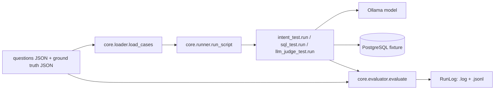

# 1. Eval Harness in 60 Seconds

This repository independently evaluates an AI application’s three read paths: intent classification, SQL generation, and grounded natural-language answers. Independence keeps fixtures, execution, and verdict logic outside the target, so application changes can be checked consistently. The harness actually runs local Ollama adapters and, for SQL, a PostgreSQL fixture; it does not call an application HTTP API. Its interesting split is contract-based deterministic checks for structured outputs and a separately prompted LLM judge for meaning-sensitive answers. Results are preserved with inputs, outputs, configuration, and file hashes.

# 2. Architecture Overview

`core.loader` is the CLI and case loader. `core.runner.SCRIPTS` wires each suite to its files, module, and mode. Adapters are the system-under-evaluation boundary: they invoke Ollama and, for SQL, the database. `core.evaluator` assigns PASS/FAIL; `core.run_log.RunLog` writes artifacts. Docker Compose supplies PostgreSQL, Ollama, and the harness; the seed profile is explicit.

# 3. Complete Evaluation Lifecycle (HIGHEST PRIORITY)

`core.loader.main` parses `--script`/`--case-id`, creates `RunLog`, and calls `run_script`. `run_script` loads question and truth arrays through `load_cases`: IDs must be unique, scalar, matched in both files, and neither file may contain `actual`. It validates adapter-facing shapes with `validate_case_payload`, imports the configured module, finds `run(input)`, and checks a judge exists for fuzzy mode.

For each case, the harness passes only the loaded `input` to the adapter. The adapter is the target behavior executed here: `intent_test.run` prompts Ollama for `{intent}`; `sql_test.run` prompts for SQL, validates it with `validate_read_query`, executes it against PostgreSQL, and returns `{sql,count}`; `llm_judge_test.run` prompts for an answer from supplied records and returns `{answer,context}`. The harness itself does not execute the production application or retrieval pipeline.

The runner sends `ground_truth` and `actual` to `evaluate`. Exact mode compares Python objects. Query-result mode executes reference SQL, extracts a strict scalar count, and compares it with `actual.count`. Fuzzy mode calls `llm_judge_test.judge`, which sends question, ideal answer, records, and generated answer to a judge model; `core.evaluator._from_judge` normalizes a strict boolean verdict. Exceptions are ERROR, not FAIL: validation, script, and evaluation stages are recorded separately, and later cases continue. `RunLog` writes human-readable `.log` and line-oriented `.jsonl`; the manifest includes model/configuration, schema version, and SHA-256 hashes of fixtures and seed SQL.

# 4. The Three Evaluation Suites

**A. Intent.** Input is a user `query`; expected output is `intent` (`read`, `write`, or `chat`) plus `actions: []`. PASS is exact JSON equality. That is appropriate for a closed enum and stable shape. Invalid JSON, unfinished thinking, extra objects, or an invalid intent raise during the adapter run and become ERROR.

**B. Retrieval / SQL.** The input is a read question plus allowed tables; the adapter generates one PostgreSQL `SELECT`, parses/guards it, executes it, and returns its count. The evaluator executes ground-truth SQL and compares counts—not SQL strings and not semantic equivalence. `core.sql_guard` rejects writes, multiple statements, `SELECT INTO`, disallowed relations, and schema bypasses; database connections are read-only with timeouts. The limitation is material: different or wrong queries can pass if they produce the same count on the current fixture, and the check is count-only.

**C. LLM-as-judge.** The judge evaluates whether a generated grounded answer addresses the question, is supported by fields, ignores instructions in untrusted records, and avoids unsupported mutation claims. It accepts equivalent wording and empty-retrieval wording. The model must return exactly `{passed:boolean, reason:string}`; malformed JSON, unknown fields, or wrong types raise ERROR. There is no retry or calibration, so model variability, judge bias, and correlated generator/judge errors remain.

# 5. Five Key Engineering Decisions

| Decision | Rationale (inferred) | Alternative / trade-off |
|---|---|---|
| Separate loader, runner, evaluator | Keeps orchestration and verdict policy testable. | One script is simpler, but harder to extend. |
| Exact equality for intent | Closed structured contract makes ambiguity unnecessary. | Semantic matching is more tolerant but can hide schema errors. |
| Execute SQL and compare counts | Tests observable database result while allowing query variation. | AST/row-set equivalence is stronger, but more complex; count collisions remain. |
| Guard generated SQL before DB execution | Limits writes and schema escape. | Database permissions alone are simpler, but give weaker application-level diagnostics. |
| Strict judge schema plus untrusted-record prompt | Makes verdicts machine-readable and addresses prompt injection. | Human review or multiple judges improves confidence but costs latency/expense. |

# 6. Reliability and Reproducibility

Loader validation, intent equality, SQL parsing, fixture checks, and count comparison are deterministic given the same files/database. Model generation and judging are probabilistic; `core.config` records model and timeout, but `retries` is explicitly `0` and no seed/temperature control is implemented. Manifests hash questions, truth, and seed SQL; logs preserve actuals and reasons. Failures are classified as FAIL (mismatch) or ERROR (validation, script, or evaluation exception).

`tests/test_harness.py` covers SQL safety, malformed counts, strict judge verdicts, prompt grounding, output parsing, loader ID behavior, seed/schema consistency, and continuation after per-case errors. It does not establish live-model judge accuracy or full end-to-end reproducibility. PROPOSED improvements: pin inference parameters/model digest, repeat judge calls, record environment/database snapshot, and add calibrated multi-judge agreement tests.

# 7. Scaling and Future Improvements

At 100,000 cases, the current sequential loop, one subprocess model call per adapter invocation, one DB connection per query, local JSONL files, and zero retries are bottlenecks. Ollama throughput, PostgreSQL contention, model/API rate limits, and judge cost dominate. A scalable design would batch or parallelize bounded work, apply per-provider concurrency/rate limits, checkpoint case IDs, retry transient failures with backoff, and write partitioned durable results. Measure latency, tokens/cost, error rate, DB saturation, queue depth, and judge agreement before choosing capacity.

PROPOSED: an HTTP runner with an explicit request/response contract; CI integration that publishes artifacts and exits on policy thresholds; regression tracking keyed by suite/case/model/configuration; and judge calibration using labeled examples, repeated judgments, and disagreement review. None is implemented here.

# 8. Interview Defence

**60 seconds.** “I built an independent harness around three AI behaviors: intent, read-only SQL, and grounded answers. JSON fixtures define cases and references; adapters invoke Ollama, SQL is guarded and executed against PostgreSQL, and a central evaluator produces exact, query-result, or judge-based verdicts. Every case and failure is logged with configuration and fixture hashes. The key limitation is that SQL is count-equivalence, while natural language is probabilistic judge evaluation.”

**3 minutes.** Walk through `loader.main` → `runner.run_script` → `load_cases`/validation → adapter `run` → `evaluate` → `RunLog`. Emphasize what the harness executes versus what the adapter/model/database execute. Then explain exact intent, guarded count-based SQL, and the grounded judge contract; finish with ERROR continuation and scaling gaps.

1. **Why independent?** It isolates evaluation from application changes and makes fixtures/verdicts reusable; the current adapters still model only these interfaces.
2. **Why not judge intent?** The enum and shape are exact, so deterministic comparison is cheaper and clearer.
3. **Multiple valid SQL answers?** Count comparison permits some variation, but count collisions are a known gap; add semantic/row-set checks if needed.
4. **Is it reproducible?** Structured checks mostly are; model calls are not. Hashes help identify inputs, but no seed or retries exist.
5. **What about judge disagreement?** Current code has one judge call; repeated or independent judges and human adjudication are PROPOSED.
6. **How scale?** Bound concurrency, respect model/DB limits, checkpoint results, retry transient errors, and measure cost/latency first.
7. **How are failures handled?** Validation, run, and evaluation exceptions become ERROR records; mismatches are FAIL; the loop continues.
8. **Architectural alternative?** An HTTP runner would test the deployed boundary, but adds service lifecycle and transport failure modes; the current direct adapters are simpler and explicitly independent.
